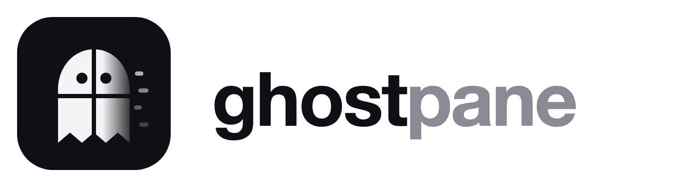
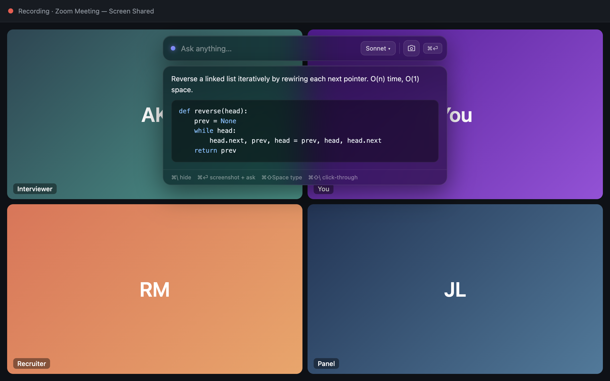

<div align="center">



**A screen-share-hidden AI overlay powered by your Claude subscription.**

[](LICENSE)
[](https://github.com/jappabl/ghostpane/releases/latest)
[](#requirements)
[](https://electronjs.org)



</div>

Ghostpane floats answers over everything you do, with no other UI. Tap one shortcut to answer what's on screen, another to get the answer explained, or hold a third to add microphone and system-audio context. Answers come from Claude Opus. The text has no outline, so it reads on dark backgrounds and fades out on white ones. The window is excluded from screen recording and screen sharing, so it does not appear in Zoom, Teams, Meet, QuickTime, or OBS.

It's an open take on the idea behind Cluely and Interview Coder, built entirely on documented macOS APIs.

## Please use it responsibly

The screen-capture exclusion is the same OS feature password managers and DRM video players use to keep sensitive windows out of screen shares. There are honest reasons to want it: private notes during your own presentations, teleprompting, accessibility, or just learning how the exclusion works.

Using it to deceive someone who has not agreed to it, like a monitored interview or a proctored exam, is dishonest, probably against that platform's rules, and entirely on you. Don't be a cheater.

## Features

- Excluded from screen shares and recordings on macOS (Zoom, Teams, Meet, screenshots; best-effort against some ScreenCaptureKit recorders and QuickTime).
- Tap `⌘⏎` for a screenshot answer. A multiple-choice question shows just the letter. Tap `⌘]` for the same answer with its reasoning. Hold `⌘⇧⏎` to record microphone and system audio, transcribe both locally, and answer using a fresh screenshot.
- Uses your Claude subscription through Claude Code, on Opus. No API key.
- Audio recording is strictly press-and-hold. Releasing the keys stops capture; raw temporary audio is deleted after local transcription.
- Streams answers token by token and grows the window to fit, then shrinks back.
- Never steals focus, has no Dock or app-switcher entry, and follows you across Spaces and over full-screen apps.
- Driven entirely by global hotkeys, so you never move the mouse to a window nobody else can see.

## Requirements

- A Mac (Apple Silicon or Intel). Held system-audio capture requires macOS 14 or newer.
- A Claude subscription signed in to [Claude Code](https://claude.com/claude-code).

## Quick start

**1. Sign in to Claude Code.** In Terminal:

```bash
curl -fsSL https://claude.ai/install.sh | bash
claude
```

Choose your Claude subscription (not an API key), sign in, then type `/exit`.

**2. Download Ghostpane.** Grab the right file from the [latest release](https://github.com/jappabl/ghostpane/releases/latest):

- Apple Silicon (M1/M2/M3): `Ghostpane-<version>-arm64.dmg`
- Intel: `Ghostpane-<version>.dmg`

(Not sure which? Apple menu > About This Mac > look at the chip.)

**3. Install it.** Open the `.dmg`, drag Ghostpane into Applications.

**4. Clear the download flag if macOS calls the app "damaged."** The app inside the DMG is signed with Ghostpane's stable self-signed identity, not an Apple Developer ID. Run this once if Gatekeeper blocks it:

```bash
xattr -cr /Applications/Ghostpane.app
```

**5. Grant permissions.** Open Ghostpane and press `⌘⏎` once. For screenshots, enable Screen Recording. For held audio, press `⌘⇧⏎`, then enable Accessibility, Microphone, and Speech Recognition. Quit (`⌘⇧Q`) and reopen after changing them. Ghostpane records only while `⌘⇧⏎` remains held.

That's it. Put a question on screen and press `⌘⏎`.

### Or let your AI assistant install it

Paste this into Claude Code, Cursor, or any AI assistant that can run commands on your Mac:

```text
Set up Ghostpane, an open-source screen-share-hidden AI overlay for macOS,
on this machine.

Repo: https://github.com/jappabl/ghostpane

1. Make sure Claude Code is installed and I have run `claude` once and
   signed in with my Claude subscription.
2. Download the right DMG from
   https://github.com/jappabl/ghostpane/releases/latest
   (arm64 for Apple Silicon, plain .dmg for Intel), open it, and move
   Ghostpane into /Applications.
3. If macOS calls the app damaged, run: xattr -cr /Applications/Ghostpane.app
4. Open Ghostpane. Walk me through granting Screen Recording (press cmd+return
   once to trigger the prompt), and for held audio also Accessibility,
   Microphone, and Speech Recognition. Remind me to quit (cmd+shift+Q) and
   reopen after granting.
5. Teach me the shortcuts: cmd+\ shows or hides the overlay, tap cmd+return
   answers what is on screen, cmd+] answers and explains, hold
   cmd+shift+return adds mic and system audio.
6. Remind me to use it responsibly: never in monitored interviews or
   proctored exams.
```

## Keyboard

There is no Dock icon by design. Everything runs through global shortcuts:

| Action | Shortcut |
| --- | --- |
| Show / hide the overlay | `⌘ \` |
| Answer what's on screen | Tap `⌘ ⏎` |
| Answer and explain | Tap `⌘ ]` |
| Add microphone + system audio | Hold `⌘ ⇧ ⏎`, release to submit |
| Scroll a long answer | `⌘ ↑` / `⌘ ↓` |
| Click-through on/off | `⌘ ⇧ \` |
| Open the logs | `⌘ ⇧ L` |
| Quit | `⌘ ⇧ Q` |

## Verify the exclusion yourself

You do not have to take the "invisible" claim on faith.

- **The 30-second test:** show the overlay, start a QuickTime recording or a Zoom "Share Screen", and play it back. The overlay you see is not in the capture.
- **The rigorous test:** `npm run verify:capture` shows a marker window and captures the screen with content protection off, then on, then off, printing a pass/fail verdict. See [docs/SMOKE.md](docs/SMOKE.md).

## How it works

The magic is one OS capability plus some overlay hygiene:

- **Screen-capture exclusion.** `BrowserWindow.setContentProtection(true)` sets the window's macOS `NSWindowSharingType` to `none`, which drops it from the capture pipeline that Zoom, Teams, and OBS read.
- **Panel window.** The overlay is created as a macOS panel (`NSWindowStyleMaskNonactivatingPanel`) so it can float over other apps' full-screen Spaces, like Spotlight, without stealing focus.
- **Subscription auth.** Ghostpane runs `claude -p` on Opus, using the subscription login Claude Code already stored.
- **Local audio context.** A bundled universal Swift helper owns the global hold gesture, captures microphone and system audio with Apple frameworks, transcribes on-device, deletes the recordings, then passes only labeled transcripts and a fresh screenshot to the selected provider.

The code splits cleanly: the Electron main process owns the window, provider routing, screenshots, and a versioned native-helper bridge; a preload script exposes a small typed API; the renderer only draws.

<details>
<summary><b>Troubleshooting</b></summary>

**"Ghostpane is damaged and can't be opened."** It isn't. macOS shows this for any non-notarized download. Run `xattr -cr /Applications/Ghostpane.app`, then open it.

**Holding `⌘⇧⏎` does not record.** Audio needs macOS 14+, plus Accessibility, Microphone, Screen Recording, and Speech Recognition access. Enable Ghostpane in all four Privacy & Security panes, then quit and reopen it. A short tap intentionally does nothing; audio requires a 350 ms hold.

**`⌘⏎` says it needs Screen Recording permission, even after I granted it.** This usually means you are running the app from the disk image or Downloads (macOS "App Translocation"), so the grant does not stick. Move Ghostpane into Applications and open it from there.

**Something is off and I want to see why.** Press `⌘⇧L` to open `~/Library/Logs/Ghostpane/ghostpane.log`. It records startup, provider CLI resolution, helper permissions, shortcuts, asks, and CLI exit codes.

**It shows up in my recording anyway.** On macOS the exclusion is reliable for Zoom/Teams/Meet sharing and for screenshots, but best-effort against some ScreenCaptureKit recorders and QuickTime. That is a documented macOS limit.

</details>

## Build from source

```bash
git clone https://github.com/jappabl/ghostpane
cd ghostpane
npm install
npm run dev     # live-reload dev build
npm test        # unit tests
npm run dist    # build the universal helper and both .dmg files into release/
```

The design spec and implementation plan live in [docs/superpowers](docs/superpowers).

## A note on signing

Ghostpane is signed with a stable self-signed certificate, not an Apple Developer ID. The release workflow fails rather than upload an unsigned app and verifies both app architectures plus the universal helper. The stable identity helps macOS retain permissions across updates, but Gatekeeper may still require the one-time `xattr` step. Developer ID signing and notarization would remove that friction and requires a paid Apple Developer account.

## License

[MIT](LICENSE)
